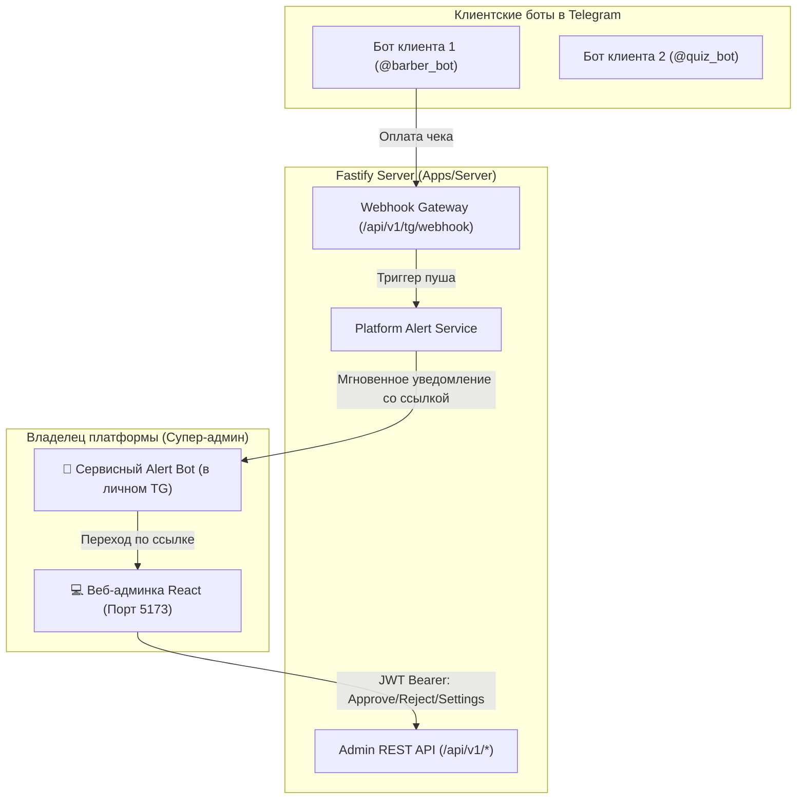

# Этап 7: Admin REST API & Сервисный Telegram-бот платформы

## Описание цели
Реализация защищённого REST API на Fastify для веб-панели управления платформой, каталога отраслевых шаблонов, API конструктора сценариев и сервисного Telegram-бота платформы (**Platform Alert Bot**) для мгновенных пуш-уведомлений супер-администратору о поступающих чеках и событиях.

---

## Архитектура и ключевые компоненты

---

## Что входит в реализацию

### 1. Безопасность и JWT Аутентификация
* **Хеширование паролей:** `argon2` для супер-админа (`AdminUser`).
* **Токены:**
  * Access-токен: короткоживущий (15 минут), передаётся в заголовке `Authorization: Bearer <token>`.
  * Refresh-токен: долгоживущий (7 дней), передаётся в защищённой `httpOnly`, `SameSite=Strict` cookie.
* **Защита от брутфорса:** `@fastify/rate-limit` на роут `/api/v1/auth/login` (максимум 10 попыток за 15 минут, при превышении $\rightarrow$ `429 Too Many Requests`).
* **Глобальный хук авторизации `onRequest`:** все эндпоинты `/api/v1/admin/*`, `/api/v1/tenants/*`, `/api/v1/bots/*`, `/api/v1/receipts/*`, `/api/v1/settings/*` закрыты, без валидного JWT возвращается `401 Unauthorized`.

### 2. Сервисный Telegram-бот платформы (Platform Alert Bot)
* **Настройки:**
  * Поля в `PlatformSettings`:
    * `alertBotTokenEnc: String?` — зашифрованный AES-256 токен сервисного бота.
    * `alertChatId: BigInt?` — ваш личный Telegram ID.
    * `alertBotUsername: String?` — имя сервисного бота (например, `@LCQB_Alert_Bot`).
  * Фолбэк в `.env`: `ALERT_BOT_TOKEN`, `ALERT_CHAT_ID`.
* **Служба отправки системных алертов (`apps/server/src/core/platform-notifier.ts`):**
  * `notifyPlatformOwner(prisma, event)`:
    * **Поступление нового чека (`NEW_RECEIPT`):**
      > 🔔 **Новый чек на проверку!**  
      > **Бот:** @barber_bot (Барбершоп)  
      > **Клиент:** @username_клиента (+998 90 *** ** 43)  
      > **Тариф:** 6 месяцев — 500 000 сум  
      > 🔗 [Открыть в веб-админке](http://localhost:5173/receipts)
    * **Создание нового бота (`BOT_REGISTERED`):**
      > 🤖 **Создан новый бот!**  
      > **Тип:** QUICKBOOK  
      > **Клиент:** Ресторан «Самарканд»  
      > **Username:** @samarkand_book_bot  
      > 🔗 [Карточка бота в админке](http://localhost:5173/bots/uuid)
    * **Блокировка бота (`BOT_BLOCKED`):**
      > 🚫 **Бот заблокирован за повторный фальшивый чек!**  
      > **Бот:** @bad_bot
  * `POST /api/v1/settings/test-alert` — тестовая кнопка для мгновенной проверки связи.

### 3. Управление клиентами (Tenants) и ботами
* `GET /api/v1/tenants` — список клиентов со статусами подписок и количеством ботов.
* `POST /api/v1/tenants` — создание нового клиента.
* `POST /api/v1/bots` — создание и подключение Telegram-бота:
  * Проверка токена через Telegram API `getMe`.
  * Шифрование токена AES-256-GCM.
  * Привязка вебхука в Telegram (`setWebhook`) с секретным токеном `webhookSecret`.
  * Автоматическое начисление бесплатного триала (`TRIAL` на `trialDays` из настроек).
  * Генерация уникальной ссылки-приглашения администратора `/start adm_<код>`.
* `POST /api/v1/bots/:id/reissue-invite` — перевыпуск ссылки-приглашения (старый код мгновенно инвалидируется).
* `GET /api/v1/bots/:id/admins` & `DELETE /api/v1/bots/:id/admins/:tgId` — просмотр и удаление администраторов бота.
* `POST /api/v1/bots/:id/extend` — **ручное продление подписки** без чека (начисление N дней/месяцев супер-админом).
* `POST /api/v1/bots/:id/unblock` — ручная разблокировка бота из статуса `BLOCKED`.

### 4. Каталог готовых отраслевых шаблонов и конструктор ботов
* `GET /api/v1/templates` — библиотека готовых шаблонов:
  * **LeadCatch (квиз-сценарии):**
    * *«Услуги и ремонт»* (тип работ, площадь/объём, удобное время, бюджет).
    * *«Медицинская клиника / Диагностика»* (специализация врача, симптомы, первично/повторно).
    * *«Автосервис / Подбор авто»* (марка, тип проблемы, срочность).
  * **QuickBook (онлайн-запись):**
    * *«Барбершоп / Салон красоты»* (мастера, стрижки, бороды, спа-уход).
    * *«Ресторан / Кафе»* (столики, основной зал/терраса/VIP, количество персон).
    * *«Медицинский центр»* (врачи, кабинеты, процедуры, график приёма).
* `POST /api/v1/bots/:id/apply-template` — применение шаблона к боту в один клик.
* `PUT /api/v1/bots/:id/settings` — API гибкого редактирования конфигурации бота:
  * Для квизов: полная валидация ориентированного ациклического графа (`validateQuizDag` — проверка циклов, связности и допустимой глубины).
  * Для онлайн-брони: валидация услуг, расписания, интервалов слотов.
  * Для системных текстов: сохранение кастомных приветствий, сбора телефона и финальных ответов на русском и узбекском.

### 5. Биллинг, проверка чеков и системные настройки
* `GET /api/v1/receipts` — фильтрация чеков по статусу (`PENDING`, `APPROVED`, `REJECTED`).
* `GET /api/v1/receipts/:id/image` — защищённый просмотр фото чека с JWT-аутентификацией (отсекает прямой неавторизованный доступ к файлам).
* `POST /api/v1/receipts/:id/approve` — одобрение чека, активация подписки, сброс счётчика ошибок, отправка пуша в Telegram клиенту.
* `POST /api/v1/receipts/:id/reject` — отклонение чека с указанием причины (`rejectionReason`), откат подписки к `prevPaidUntil`, переход в `GRACE_PERIOD` или `BLOCKED`.
* `GET /api/v1/settings` & `PUT /api/v1/settings`:
  * Реквизиты оплаты (карта, банк, получатель).
  * Стоимость тарифов (1, 6, 12 месяцев).
  * Текст инструкции по оплате (`paymentInstructions`).
  * Режим технического перерыва (`maintenanceMode`).
  * Токен и Chat ID системного бота уведомлений платформы.

### 6. OpenAPI / Swagger Документация
* Роут `/docs`: автогенерируемый интерактивный UI (`@fastify/swagger` + `@fastify/swagger-ui`) для тестирования всех запросов прямо из браузера.

---

## План верификации и тестов

### Автоматизированные тесты (`apps/server/test/admin-api.test.ts`)
1. **Безопасность роутов:**
   * Обход всех зарегистрированных Fastify-роутов без JWT $\rightarrow$ строго `401 Unauthorized`.
   * 10 неудачных попыток входа с неверным паролем $\rightarrow$ блокировка `429 Too Many Requests`.
2. **Управление ботами и шаблонами:**
   * Получение списка шаблонов `GET /api/v1/templates`.
   * Применение шаблона к боту `POST /api/v1/bots/:id/apply-template`.
   * Попытка сохранить квиз с циклом или битыми шагами $\rightarrow$ строгий отказ `400 Bad Request` с детальным описанием ошибки DAG.
   * Попытка создать бота с невалидным токеном Telegram $\rightarrow$ отказ `400 Bad Request`.
3. **Управление доступом:**
   * Перевыпуск инвайт-кода админа $\rightarrow$ старая ссылка `/start adm_старый_код` больше не даёт прав администратора.
4. **Биллинг и ручное продление:**
   * Ручное продление подписки супер-админом через `POST /api/v1/bots/:id/extend` на 30 дней без чека $\rightarrow$ подписка активна.
   * Одобрение и отклонение чеков через REST API с проверкой отката.
5. **Сервисный бот уведомлений:**
   * Тест `notifyPlatformOwner`: при поступлении чека отправляется структурированный пуш в сервисный бот супер-админа.
   * Тест `POST /api/v1/settings/test-alert` $\rightarrow$ успешная отправка.
6. **Полный Quality Gate:**
   * `pnpm typecheck` $\rightarrow$ 0 ошибок
   * `pnpm lint` $\rightarrow$ 0 ошибок (файлы $< 300$ строк)
   * `pnpm depcruise` $\rightarrow$ 0 нарушений слоёв
   * `pnpm knip` $\rightarrow$ 0 неиспользуемого кода
   * `pnpm check-mocks` $\rightarrow$ 0 нарушений
   * `pnpm test` $\rightarrow$ 100% зелёных тестов
   * `pnpm build` $\rightarrow$ успешная сборка всех пакетов

---

## Ручная проверка пользователем
1. Создать в [@BotFather](https://t.me/BotFather) сервисного бота (например, `@LCQB_Alert_Bot`), скопировать токен и отправить ему `/start`.
2. В админке перейти в раздел настроек, сохранить токен и свой Telegram Chat ID и нажать кнопку «Проверить связь» $\rightarrow$ убедиться, что в Telegram пришёл тестовый пуш.
3. Отправить чек в клиентском боте $\rightarrow$ убедиться, что в сервисный бот мгновенно прилетело уведомление со ссылкой на админку.
