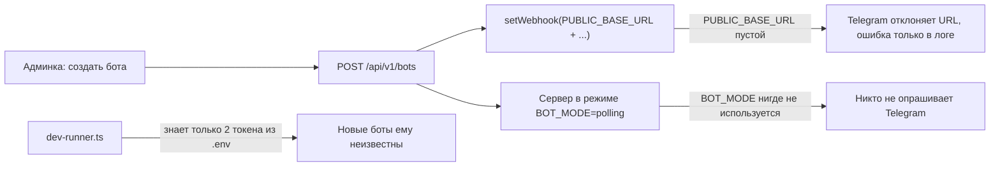

# Этап 8.5: рабочие боты из админки, исправления аудита и визуальные редакторы

> Внесён в главный план [implementation_plan.md](file:///f:/Рабочий%20стол/AAA/implementation_plan.md) как отдельный этап перед этапом 9. Копия: `docs/stage_8_5_fix_plan.md`.

## Цель
1. Бот, созданный в админке, **сразу начинает отвечать в Telegram** (локально и в проде).
2. Исправить 7 критических и самые важные дефекты из [AUDIT_REPORT.md](file:///f:/Рабочий%20стол/AAA/.agents/teamwork/AUDIT_REPORT.md).
3. Заменить JSON-редакторы на **визуальные формы**: вопросы квиза, услуги, мастера, график.

---

## Почему бот из админки сейчас молчит (найденная причина)



- [env.ts:16](file:///f:/Рабочий%20стол/AAA/apps/server/src/core/env.ts#L16) объявляет `BOT_MODE=polling`, но **ни один модуль сервера его не читает**.
- [bots.ts:237-246](file:///f:/Рабочий%20стол/AAA/apps/server/src/admin-api/bots.ts#L237-L246) пытается поставить webhook с пустым `PUBLIC_BASE_URL` — Telegram отказывает, ошибка проглатывается.
- [dev-runner.ts](file:///f:/Рабочий%20стол/AAA/apps/server/src/dev-runner.ts) запускает polling только для `DEV_LEADCATCH_TOKEN` и `DEV_QUICKBOOK_TOKEN`.
- Дополнительно: ссылка-приглашение создаётся **без `adm_`** ([bots.ts:117, 268](file:///f:/Рабочий%20стол/AAA/apps/server/src/admin-api/bots.ts#L117)), поэтому админ не назначается; квиз из админки бот **не видит** ([quiz-flow.ts:26](file:///f:/Рабочий%20стол/AAA/apps/server/src/bots/leadcatch/quiz-flow.ts#L26)); дефолтный квиз нового бота **невалиден** (`text` вместо `title`, `type: INFO`).

---

## User Review Required

> [!IMPORTANT]
> **Режим polling будет встроен в основной сервер.** При `BOT_MODE=polling` сервер сам запускает long polling для всех активных ботов из БД и подхватывает новых, созданных в админке. Скрипт `pnpm dev:bot` станет не нужен; одновременный запуск обоих даст ошибку Telegram `409 Conflict` (один токен — один poller). Я оставлю `dev-runner.ts` только как сидер тестовых ботов (без polling).

> [!WARNING]
> **Сессия в админке.** После исправления CRIT-02 текущий токен в браузере станет невалидным — нужно будет войти один раз заново.

> [!NOTE]
> **Пути к чекам.** Старые записи с абсолютным путём продолжат открываться (берётся `basename` и ищется внутри `UPLOAD_DIR`). Миграция БД не нужна.

---

## Open Questions

> [!IMPORTANT]
> **1. Типы вопросов в квизе LeadCatch.** Сейчас бот поддерживает **только вопросы с кнопками**. Телефон спрашивается автоматически в конце. Варианты:
> - **(а) Рекомендую для пилота:** визуальный редактор для текущей модели (вопрос + кнопки + «куда ведёт кнопка»), без изменения логики бота.
> - **(б)** Добавить новые типы: «Свободный текст» (имя, комментарий) и «Информационное сообщение». Для этого придётся менять схему контрактов и FSM бота — примерно +1 день и новые тесты.

> [!IMPORTANT]
> **2. Объём текущей итерации.** Выполнять волны 1–3 сейчас, а волну 4 (масштабирование, таймзона, декомпозиция файлов) после пилотов? Или всё сразу?

---

## Proposed Changes

### Волна 1 — Боты из админки работают в Telegram

#### [NEW] `apps/server/src/gateway/polling-manager.ts`
- `PollingManager` с методами `startAll()`, `start(botId)`, `stop(botId)`, `stopAll()`.
- При старте читает все `isActive` боты, берёт экземпляр через существующий `BotPool`, вызывает `deleteWebhook` и `bot.start()`. Каждый апдейт обрабатывается через тот же `AsyncLocalStorage`-контекст, что и webhook.
- Ошибки одного бота (неверный токен, 401 от Telegram) логируются и не мешают остальным.

#### [MODIFY] [index.ts](file:///f:/Рабочий%20стол/AAA/apps/server/src/index.ts)
- `if (env.BOT_MODE === "polling")` → создать `PollingManager`, запустить `startAll()` после `listen`, остановить в `onClose`.
- Передать менеджер в `registerAdminApi`.

#### [MODIFY] [bots.ts](file:///f:/Рабочий%20стол/AAA/apps/server/src/admin-api/bots.ts), [bots-lifecycle.ts](file:///f:/Рабочий%20стол/AAA/apps/server/src/admin-api/bots-lifecycle.ts), [bots-ops.ts](file:///f:/Рабочий%20стол/AAA/apps/server/src/admin-api/bots-ops.ts)
- Создание и возобновление бота: в polling-режиме вызывать `pollingManager.start(id)`, в webhook-режиме — `setWebhook`.
- Приостановка и удаление: `pollingManager.stop(id)`.
- Если `BOT_MODE=webhook`, а `PUBLIC_BASE_URL` пуст, возвращать `warning` в ответе, а не молчать (MAJ-17).
- Ссылка-приглашение: `?start=adm_${adminInviteCode}` (MAJ-01).
- Дефолтные настройки нового LeadCatch-бота = `DEFAULT_LEADCATCH_QUIZ` (MAJ-11). Срок триала = `env.TRIAL_DAYS_DEFAULT` (MIN-02).

#### [MODIFY] [quiz-flow.ts](file:///f:/Рабочий%20стол/AAA/apps/server/src/bots/leadcatch/quiz-flow.ts) — CRIT-04
```ts
const raw = settings && "quiz" in settings ? settings.quiz : settings;
const parsed = QuizConfigSchema.safeParse(raw);
if (parsed.success && validateQuizDag(parsed.data).valid) return parsed.data;
return DEFAULT_LEADCATCH_QUIZ;
```

#### [MODIFY] [admin-menu.ts](file:///f:/Рабочий%20стол/AAA/apps/server/src/bots/shared/admin-menu.ts) — CRIT-05
- `resolveTariffPrices` понимает массив `[{months, amountUzs}]` (основной формат) и старый объект `{"1m": ...}`.

#### [MODIFY] [dev-runner.ts](file:///f:/Рабочий%20стол/AAA/apps/server/src/dev-runner.ts)
- Только регистрирует тестовых ботов в БД и печатает ссылки, polling не запускает.

---

### Волна 2 — Безопасность и надёжность (CRIT-01, 02, 03, 06, 07) — [ВЫПОЛНЕНО]

#### [MODIFY] [receipt-storage.ts](file:///f:/Рабочий%20стол/AAA/apps/server/src/bots/shared/receipt-storage.ts), [receipts.ts](file:///f:/Рабочий%20стол/AAA/apps/server/src/admin-api/receipts.ts) — CRIT-01, MAJ-10
- В БД сохраняется только имя файла.
- Отдача: `path.resolve(UPLOAD_DIR, path.basename(imagePath))` с проверкой, что путь лежит внутри `UPLOAD_DIR`, иначе 404. MIME-тип `.webp` → `image/webp`.

#### [MODIFY] [auth.ts](file:///f:/Рабочий%20стол/AAA/apps/server/src/admin-api/auth.ts), [admin-api/index.ts](file:///f:/Рабочий%20стол/AAA/apps/server/src/admin-api/index.ts) — CRIT-02
- В payload добавляется `tokenType: "access" | "refresh"`. Refresh подписывается и проверяется секретом `JWT_REFRESH_SECRET`.
- `authenticateAdmin` отклоняет любой токен, кроме `access`.

#### [MODIFY] [scheduler.ts](file:///f:/Рабочий%20стол/AAA/apps/server/src/workers/scheduler.ts), [index.ts](file:///f:/Рабочий%20стол/AAA/apps/server/src/index.ts) — CRIT-03
- `inboxService.recoverPending(100)` при старте и периодически раз в 60 с внутри планировщика.

#### [MODIFY] [lru.ts](file:///f:/Рабочий%20стол/AAA/apps/server/src/core/lru.ts), [bot-pool.ts](file:///f:/Рабочий%20стол/AAA/apps/server/src/gateway/bot-pool.ts) — CRIT-06
- `LruCache` получает `onEvict`. При вытеснении бота чистятся `cachedTokens` и `latestMeta`. Бот, которого опрашивает polling, «закрепляется» и из кэша не вытесняется.

#### [MODIFY] Админка: `api/receipts.ts`, `pages/ReceiptsPage.tsx` — CRIT-07
- Картинка загружается через `fetch` с Bearer-токеном, затем показывается через `URL.createObjectURL`. Токен в URL не попадает.

---

### Волна 3 — Удобная админка (визуальные редакторы и UX) [ВЫПОЛНЕНО: 12.10.2026]

#### [COMPLETED] `apps/admin/src/components/bots/quiz/QuestionCard.tsx`, `OptionRow.tsx`, `QuizFlowPreview.tsx`
#### [COMPLETED] [BotQuizEditorTab.tsx](file:///f:/Рабочий%20стол/AAA/apps/admin/src/components/bots/BotQuizEditorTab.tsx)
- Список вопросов карточками: номер, **текст RU / UZ**, кнопки **«↑ / ↓»** для порядка, «Удалить», генерация ID.
- В каждом вопросе — варианты-кнопки: текст RU/UZ и выпадающий список **«После ответа → [Вопрос N | Конец, спросить телефон]»**.
- «Первый вопрос» выбирается радио-кнопкой / переключателем «Сделать стартом».
- ID генерируются автоматически, вручную их вводить не нужно.
- Живая синхронизация с JSON и валидация DAG со списком ошибок от бэкенда.
- Справа интерактивное превью: симуляция Telegram-диалога (пузырь сообщения и кликабельные кнопки, выбор языка RU/UZ).

#### [COMPLETED] `components/bots/schedule/ServiceList.tsx`, `ResourceList.tsx`, `WeekDaysPicker.tsx`
#### [COMPLETED] [BotScheduleEditorTab.tsx](file:///f:/Рабочий%20стол/AAA/apps/admin/src/components/bots/BotScheduleEditorTab.tsx)
- **Услуги:** таблица/карточки с полями «Название RU / UZ», «Длительность» (15/30/45/60/90/120/180 мин), «Цена, сум», добавление и удаление.
- **Мастера:** имя RU/UZ, переключатели дней недели «Пн…Вс», время «с–до» (`<input type="time">`), мультивыбор закрепленных услуг.
- **Общие:** шаг слота (15/30/45/60), горизонт записи в днях, тип ресурсов (STAFF/TABLE/ROOM).
- Переключение между визуальным и прямым JSON-режимом.

#### [COMPLETED] Прочие UX-исправления
- **Тихий рефреш токена** (MAJ-05): при 401 — запрос `/api/v1/auth/refresh` с дедупликацией промиса и повтором запроса.
- Статус клиента «Приостановлен» отображается корректно (MAJ-06) на базе `t.status === "SUSPENDED" || t.isSuspended`.
- Баннер 429 на логине по `ApiError.statusCode === 429` (MAJ-15). Удалены дефолтные credentials из UI (MAJ-02).
- `alertChatId` изменен на `VARCHAR(100)` в Prisma/PostgreSQL, принимает `@channel` и числовые ID без краша (MAJ-07).
- В шапке бота и таблице плашка **«Бот онлайн / Приостановлен»** с анимацией pulse, кнопка «Открыть в Telegram» и чеклист запуска в `CreateBotModal` (MAJ-16, MAJ-18).

---

### Волна 4 — Масштабирование и таймзона (можно после пилотов)
- MAJ-04: лимит inflight по каждому боту, плюс глобальный потолок.
- MAJ-08: все календарные расчёты в `Asia/Tashkent`.
- MAJ-12: разбить 5 файлов, которые больше 300 физических строк.
- MIN-08: режим техперерыва реально блокирует ботов.

---

## Verification Plan

### Automated Tests
Новые и обновлённые тесты в `apps/server/test/`:
- `polling-manager.test.ts`: `startAll` поднимает только активные боты; `stop` после приостановки; ошибка одного бота не роняет остальных (mock-transport).
- `quiz-flow`: квиз в корне `settings` и в `settings.quiz` читается; невалидный → дефолт.
- `admin-menu`: тарифы из массива применяются.
- `admin-api.test.ts`: ссылка содержит `adm_`; refresh-токен отклоняется на защищённых маршрутах (401); `../../.env` в `imagePath` → 404; WebP → `image/webp`.
- `inbox recovery`: зависший `RECEIVED` обрабатывается после вызова планировщика.
- `bot-pool`: после вытеснения размеры `cachedTokens` и `latestMeta` не растут.

```powershell
pnpm verify
```
Ожидается код выхода 0: typecheck, lint, depcruise, knip, check-mocks, все тесты, build.

### Manual Verification
1. Остановить `pnpm dev:bot`, запустить `pnpm dev:server` и `pnpm dev:admin`.
2. В админке создать клиента → бота с новым токеном → нажать «Открыть в Telegram» → `/start` → бот отвечает.
3. Перейти по ссылке админа → в боте появляется меню администратора.
4. Во вкладке «Квиз» собрать 3 вопроса мышкой, сохранить → `/start` в боте показывает новые вопросы.
5. Во вкладке «Расписание» добавить мастера и услугу → бот предлагает их при записи.
6. Изменить цену тарифа в настройках → в боте «Подписка» показывает новую цену.
7. Отправить чек фото → в админке картинка видна → «Одобрить».
