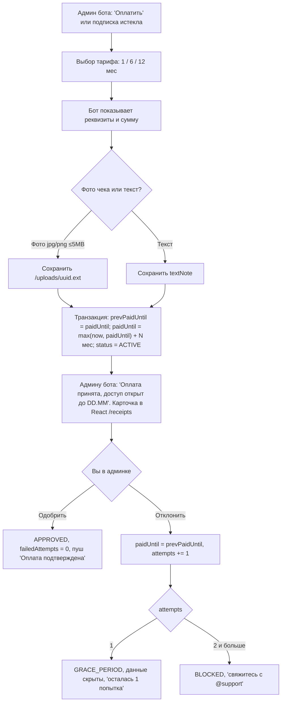
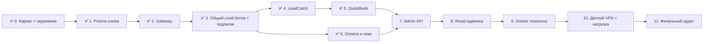

# План реализации: LeadCatch & QuickBook Platform (v2)

Мультитенантная платформа: **один процесс Node.js** (Fastify + grammY + Prisma) обслуживает любое число Telegram-ботов двух типов через единый webhook-шлюз. Данные хранятся в PostgreSQL 16, состояния и блокировки — в Redis, управление идёт через React-админку. Целевой хостинг — VPS с 2 GB RAM.

---

## Что изменилось по вашим ответам

| # | Решение |
|---|---|
| 1 | Стек: **Node.js + TypeScript + Fastify + grammY + Prisma** (ORM выбран по вашему запросу) |
| 2 | При создании бота админка выдаёт **ссылку-приглашение** `t.me/<bot>?start=adm_<код>`. Кто перешёл по ней, становится **админом этого бота**; обычный `/start` — клиент. У одного бота может быть несколько админов. Оплата и чеки идут **в том же боте** |
| 3 | Тарифы: **1 мес — 100 000 сум, 6 мес — 500 000, 12 мес — 1 000 000**. После отправки чека подписка **сразу продлевается** на выбранный срок, а вы проверяете чек в админке. Если отклонили — срок откатывается |
| 4 | **Prisma-схема создаётся первой** (этап 1). Postgres и Redis ставятся локально **без Docker** (инструкция ниже) |
| 5 | Часовой пояс **Asia/Tashkent**. При первом `/start` выбор языка **🇺🇿 O'zbek / 🇷🇺 Русский**. Вместо ссылок на оплату — **текст реквизитов**. Подтверждение — **фото чека ИЛИ текстовое сообщение** («отправил в 14:30 с карты *1234») |
| 6 | **Docker** появляется только на этапах 9–10 |

---

## User Review Required

> [!WARNING]
> **Ссылка-приглашение = полный доступ к данным бота.** Если клиент перешлёт её постороннему, тот увидит лиды. Поэтому в админке будут: список админов бота с кнопкой «Удалить» и кнопка **«Перевыпустить ссылку»** (старая перестаёт работать).

> [!IMPORTANT]
> **Поведение при окончании триала или подписки** (едино для обоих ботов, как вы описали):
> - **Клиенты бота** ничего не замечают: квиз проходится, запись создаётся.
> - **Админ бота** получает уведомления с **замаскированными** данными (`+998 90 *** ** 67`, имя скрыто) и сообщение **«Оплатите подписку»** с кнопками выбора тарифа.
> - Для QuickBook это **отличается от ТЗ**, где предлагались «технические работы» для клиентов. Делаю по-вашему: клиенты записываются всегда, у админа данные скрыты.

> [!NOTE]
> **Статусы подписки** (уточнённый enum):
> - `TRIAL` — триал (по умолчанию 3 дня), данные видны;
> - `ACTIVE` — оплачено (включая период проверки чека), данные видны;
> - `EXPIRED` — срок вышел, данные скрыты, просим оплату;
> - `GRACE_PERIOD` — первый чек отклонён, данные скрыты, «осталась 1 попытка»;
> - `BLOCKED` — второй чек отклонён, данные скрыты, оплата через бота закрыта, «свяжитесь с @support». Разблокировать можно только вручную в админке.

## Подтверждённые решения
1. После одобренного чека счётчик неудачных чеков сбрасывается в 0.
2. В React-админку входит один супер-админ, логин и пароль берутся из `.env` (seed).
3. Реквизиты, цены тарифов и контакт поддержки хранятся в `platform_settings` и редактируются в админке.
4. Админ бота в Telegram: уведомления, последние 20 заявок или записей, «Подписка», «Язык». Настройки квиза и расписания — только в React-админке.
5. В админке есть список админов бота с кнопкой «Удалить» и кнопка «Перевыпустить ссылку».

---

## Что делает агент сам, а что — вы

### Агент делает сам (через терминал Antigravity)
- Проверяет версии `node`, `pnpm`, `psql`, `redis-cli` и сообщает, чего не хватает.
- **Создаёт базы данных и отдельного пользователя БД** (не суперпользователя `postgres`):
  - `leadcatch_quickbook_dev` — для разработки;
  - `leadcatch_quickbook_test` — для автотестов (очищается при каждом прогоне);
  - пользователь `lcqb_app` со случайным паролем, владелец обеих баз.
- Прописывает `DATABASE_URL` и `TEST_DATABASE_URL` в `.env`, накатывает миграции и seed.
- `git init`, `.gitignore` (`.env`, `uploads/`, `node_modules/` никогда не попадут в git).

> [!NOTE]
> Команды, которые подключаются к локальному Postgres или Redis и скачивают пакеты (`pnpm install`), будут запрашивать **ваше подтверждение** (кнопка Approve). Можно один раз нажать «Always allow» для `psql` и `pnpm`.

### Вы делаете сами (до этапа 0)
| # | Что | Зачем |
|---|---|---|
| 1 | Установить **Node.js 22 LTS** (`winget install OpenJS.NodeJS.LTS`), затем `corepack enable` | рантайм и pnpm |
| 2 | Установить **PostgreSQL 16** (`winget install PostgreSQL.PostgreSQL.16`) и при установке **запомнить пароль `postgres`**. Установщику нужны права администратора | база |
| 3 | Установить **Memurai Developer** (`winget install Memurai.MemuraiDeveloper`) | Redis |
| 4 | Положить пароль `postgres` в файл `.env.setup` в корне проекта: `PG_SUPERUSER_PASSWORD=...`. Агент использует его **один раз** для создания баз и пользователя, затем удаляет файл | создание БД |
| 5 | Создать в **@BotFather** 2 тестовых бота: `/newbot` → например `lcqb_lead_test_bot` и `lcqb_book_test_bot`. Токены **не вставлять в чат с агентом**; они понадобятся на этапе 8 для ввода в React-админку, а до этого — в `.env` (`DEV_LEADCATCH_TOKEN`, `DEV_QUICKBOOK_TOKEN`) для ручных проверок в режиме polling | тест в живом Telegram |
| 6 | Подготовить **второй Telegram-аккаунт** (или друга с телефоном): один аккаунт будет админом бота, второй — клиентом. Иначе маскировку и уведомления не проверить | роли админ/клиент |
| 7 | Заполнить в `.env` значения: `SUPERADMIN_EMAIL`, `SUPERADMIN_PASSWORD`, реквизиты карты, контакт поддержки (`@...`) | seed |

### Позже
| Этап | Что нужно от вас |
|---|---|
| 9 | Установить **Docker Desktop** (`winget install Docker.DockerDesktop`, включить WSL2, перезагрузка) |
| 10 | Арендовать **VPS** (Ubuntu 24.04, 2 GB RAM) и **домен** (или бесплатный поддомен, например DuckDNS): Let's Encrypt и вебхуки Telegram требуют HTTPS на домене. Дать агенту SSH-доступ или выполнять команды, которые он подготовит |
| 11 | Пройти живой smoke-тест с двух аккаунтов |

---

## Модели и экономия лимита Claude

Есть три уровня. **Claude используем только там, где ошибка стоит денег или данных** (гонки, транзакции, безопасность).

| Модель | Когда использовать | Этапы |
|---|---|---|
| **Claude (Sonnet/Opus)** — дорогой, лимит маленький | Сложная конкурентная логика: webhook-шлюз и идемпотентность, Redis-локи бронирования, транзакции биллинга с откатом | **2, 5, 6** (≈25 % работы) |
| **Gemini Pro** (последняя доступная, 3.x Pro) | Проектирование (Prisma-схема), движок квиза, подписки, Admin API, конфиги nginx/compose, **ревью в конце каждого этапа** (вмещает весь репозиторий) | 1, 3, 4, 7, 10, 11 + все ревью |
| **Gemini Flash** (3.x Flash) — быстрый и почти безлимитный | Шаблонный код: каркас монорепо, конфиги ESLint/TS, i18n-словари RU/UZ, CRUD-страницы React, Dockerfile, **написание тестов по готовому ТЗ**, **запуск `pnpm verify` и исправление ошибок линтера и типов** | 0, 8, 9, а также рутина внутри любого этапа |

**Правила экономии:**
- Рутинные хвосты этапа (починить линт, дописать тест, переименовать) отдаются **Flash**, даже на «Claude-этапах».
- В Claude отправляйте **узкую задачу**: только нужные файлы и один ключевой модуль («реализуй `booking.service.ts` и `slot-lock.ts` по плану этапа 5»), а не «сделай этап».
- Если на Claude-этапе лимит кончился, его делает Gemini Pro, но тогда **обязательно** прогоняются тесты гонок этого этапа (они специально написаны так, чтобы ловить ошибки слабой модели).

---

## Структура репозитория

> [!IMPORTANT]
> Боты — **не отдельные приложения**, а модули одного сервера. Отдельно лежит только React-админка.

```
leadcatch-platform/
├── apps/
│   ├── server/                       # ЕДИНЫЙ процесс Node.js
│   │   ├── prisma/
│   │   │   ├── schema.prisma         # ← создаётся ПЕРВЫМ (этап 1)
│   │   │   ├── migrations/
│   │   │   └── seed.ts               # супер-админ, platform_settings, тарифы
│   │   ├── src/
│   │   │   ├── core/                 # env (Zod), logger (pino), prisma, redis, crypto
│   │   │   ├── gateway/              # webhook-роут, резолв бота, идемпотентность update_id
│   │   │   ├── bots/
│   │   │   │   ├── shared/           # язык, роли/приглашения, i18n, маскировка, оплата/чеки, меню админа
│   │   │   │   ├── leadcatch/        # DAG-квиз, сбор контакта
│   │   │   │   └── quickbook/        # услуги → мастер → дата → слот, локи, напоминания
│   │   │   ├── admin-api/            # REST для React: auth, tenants, bots, receipts, settings
│   │   │   ├── workers/              # истечение подписок, напоминания (Redis ZSET)
│   │   │   └── adapters/             # TelegramTransport: Real | Mock (через ENV)
│   │   └── test/
│   └── admin/                        # React + Vite + Tailwind + Lucide
├── packages/
│   └── contracts/                    # Zod-схемы DTO (общие для server и admin)
├── infra/                            # (этапы 9–10) Dockerfile, compose, nginx
├── scripts/                          # verify, check-mocks, load-test
└── *.md                              # ТЗ и правила
```

---

## Локальное окружение без Docker (лёгкое для ноутбука)

### PostgreSQL 16 (нативно)
1. Установить: `winget install PostgreSQL.PostgreSQL.16` (или установщик EDB с postgresql.org). Пароль для `postgres` запомнить.
2. **Чтобы не грузил ноут**, убрать автозапуск и включать только на время работы (PowerShell от администратора):
   ```powershell
   Set-Service postgresql-x64-16 -StartupType Manual
   Start-Service postgresql-x64-16     # начать работу
   Stop-Service  postgresql-x64-16     # закончить
   ```
3. Добавить `C:\Program Files\PostgreSQL\16\bin` в PATH. **Базы создаёт агент на этапе 0** (пароль берёт из `.env.setup`):
   ```powershell
   psql -U postgres -h localhost -c "CREATE ROLE lcqb_app LOGIN PASSWORD '<сгенерированный>';"
   psql -U postgres -h localhost -c "CREATE DATABASE leadcatch_quickbook_dev OWNER lcqb_app;"
   psql -U postgres -h localhost -c "CREATE DATABASE leadcatch_quickbook_test OWNER lcqb_app;"
   ```
4. **Открыть базу через терминал:**
   ```powershell
   psql -U lcqb_app -h localhost -d leadcatch_quickbook_dev
   ```
   Полезные команды внутри `psql`: `\dt` (таблицы), `\d bots` (структура таблицы), `SELECT * FROM leads LIMIT 10;`, `\x` (вертикальный вывод), `\q` (выход).
5. Визуально (легче pgAdmin): `pnpm --filter server exec prisma studio` открывает таблицы в браузере на `localhost:5555`.
6. Лёгкий конфиг для ноутбука (`postgresql.conf`): `shared_buffers = 128MB`, `max_connections = 20`.

### Redis (нативно на Windows)
Официального Redis под Windows нет. Варианты:
- **Memurai Developer** (Redis-совместимый, бесплатный): `winget install Memurai.MemuraiDeveloper`. Также переключить службу на ручной запуск: `Set-Service Memurai -StartupType Manual`.
- Или через WSL2: `wsl --install` → `sudo apt install redis-server`.

### Telegram-вебхуки локально
- Режим `BOT_MODE=polling` (**только для разработки**, 1–2 тестовых бота), чтобы не нужен был туннель.
- Для проверки настоящего webhook-пути: `winget install Cloudflare.cloudflared` → `cloudflared tunnel --url http://localhost:8000`.

---

## Prisma-схема (черновик этапа 1)

```prisma
generator client {
  provider = "prisma-client"          // Prisma 7: без Rust-движка, меньше RAM
  output   = "../src/generated/prisma"
}
datasource db { provider = "postgresql" }  // URL в prisma.config.ts из .env

enum BotType       { LEADCATCH QUICKBOOK }
enum SubStatus     { TRIAL ACTIVE EXPIRED GRACE_PERIOD BLOCKED }
enum ReceiptKind   { PHOTO TEXT }
enum ReceiptStatus { PENDING APPROVED REJECTED }
enum BookingStatus { PENDING CONFIRMED CANCELLED COMPLETED }
enum Lang          { RU UZ }

model Tenant {
  id           String   @id @default(uuid()) @db.Uuid
  clientName   String   @db.VarChar(255)
  contactPhone String   @db.VarChar(50)
  createdAt    DateTime @default(now()) @db.Timestamptz
  bots         Bot[]
}

model Bot {
  id              String   @id @default(uuid()) @db.Uuid
  tenantId        String   @db.Uuid
  tenant          Tenant   @relation(fields: [tenantId], references: [id], onDelete: Cascade)
  botType         BotType
  botTokenEnc     String                       // AES-256-GCM, ключ в ENV
  botTokenHash    String   @unique @db.VarChar(64)  // sha256 → URL вебхука
  webhookSecret   String   @db.VarChar(64)     // X-Telegram-Bot-Api-Secret-Token
  botUsername     String?  @db.VarChar(100)
  adminInviteCode String   @unique @db.VarChar(32)  // перевыпускается из админки
  settings        Json     @default("{}")      // квиз / услуги, мастера, расписание
  createdAt       DateTime @default(now()) @db.Timestamptz
  subscription    Subscription?
  users           BotUser[]
  leads           Lead[]
  bookings        Booking[]
  receipts        PaymentReceipt[]
}

model Subscription {
  id                    String    @id @default(uuid()) @db.Uuid
  botId                 String    @unique @db.Uuid
  bot                   Bot       @relation(fields: [botId], references: [id], onDelete: Cascade)
  status                SubStatus @default(TRIAL)
  trialEndsAt           DateTime  @db.Timestamptz
  paidUntil             DateTime? @db.Timestamptz
  failedReceiptAttempts Int       @default(0)
  updatedAt             DateTime  @updatedAt @db.Timestamptz
}

model BotUser {                      // и клиенты, и админы бота
  id        String   @id @default(uuid()) @db.Uuid
  botId     String   @db.Uuid
  bot       Bot      @relation(fields: [botId], references: [id], onDelete: Cascade)
  tgId      BigInt
  firstName String?  @db.VarChar(255)
  username  String?  @db.VarChar(100)
  lang      Lang?
  isAdmin   Boolean  @default(false)
  createdAt DateTime @default(now()) @db.Timestamptz
  @@unique([botId, tgId])
  @@index([botId, isAdmin])
}

model PaymentReceipt {
  id              String        @id @default(uuid()) @db.Uuid
  botId           String        @db.Uuid
  bot             Bot           @relation(fields: [botId], references: [id], onDelete: Cascade)
  submittedByTgId BigInt
  kind            ReceiptKind
  imagePath       String?       @db.VarChar(500)   // только для PHOTO, имя = uuidv4
  telegramFileId  String?       @db.VarChar(255)
  textNote        String?                          // для TEXT: «отправил в 14:30...»
  months          Int                              // 1 | 6 | 12
  amount          Int                              // сум, фиксируется на момент оплаты
  prevPaidUntil   DateTime?     @db.Timestamptz    // для отката при отклонении
  prevStatus      SubStatus
  grantedUntil    DateTime      @db.Timestamptz
  status          ReceiptStatus @default(PENDING)
  rejectionReason String?
  createdAt       DateTime      @default(now()) @db.Timestamptz
  reviewedAt      DateTime?     @db.Timestamptz
  @@index([status, createdAt])
}

model Lead {
  id               String   @id @default(uuid()) @db.Uuid
  botId            String   @db.Uuid
  bot              Bot      @relation(fields: [botId], references: [id], onDelete: Cascade)
  customerTgId     BigInt
  customerName     String?  @db.VarChar(255)
  customerUsername String?  @db.VarChar(100)
  phoneRaw         String   @db.VarChar(50)
  answers          Json
  isMasked         Boolean  @default(false)
  createdAt        DateTime @default(now()) @db.Timestamptz
  @@index([botId, createdAt])
}

model Booking {
  id            String        @id @default(uuid()) @db.Uuid
  botId         String        @db.Uuid
  bot           Bot           @relation(fields: [botId], references: [id], onDelete: Cascade)
  customerTgId  BigInt
  customerName  String?       @db.VarChar(255)
  customerPhone String        @db.VarChar(50)
  serviceId     String        @db.VarChar(64)
  serviceName   String        @db.VarChar(255)
  staffId       String        @db.VarChar(64)
  durationMin   Int
  slotTime      DateTime      @db.Timestamptz
  status        BookingStatus @default(PENDING)
  reminderSent  Boolean       @default(false)
  isMasked      Boolean       @default(false)
  createdAt     DateTime      @default(now()) @db.Timestamptz
  @@index([botId, slotTime])
}

model Admin {
  id           String @id @default(uuid()) @db.Uuid
  email        String @unique
  passwordHash String
}

model PlatformSettings {
  id             Int    @id @default(1)
  paymentDetails String          // текст реквизитов (карта, получатель)
  tariffs        Json            // [{months:1,amount:100000},{months:6,amount:500000},{months:12,amount:1000000}]
  supportContact String          // @support
}
```

> [!NOTE]
> Prisma не умеет частичные индексы в схеме, поэтому защита от двойной записи добавляется **ручной SQL-миграцией** (`prisma migrate dev --create-only`, затем дописать SQL):
> ```sql
> CREATE UNIQUE INDEX booking_slot_active_uq ON "Booking"("botId","staffId","slotTime")
>   WHERE status IN ('PENDING','CONFIRMED');
> ```

---

## Логика оплаты (этап 6)



Если `prevPaidUntil` после отката ещё в будущем (продлевали заранее), статус возвращается в `ACTIVE` и счётчик всё равно увеличивается.

---

## Quality Gate: `pnpm verify`

Настраивается на этапе 0 и запускается **агентом в конце каждого этапа**. Падает на первой ошибке.

| # | Проверка | Что ловит |
|---|---|---|
| 1 | `prisma validate` + `prisma migrate status` | схема и миграции не расходятся |
| 2 | `tsc --noEmit` (strict, `noUncheckedIndexedAccess`) | ошибки типов |
| 3 | ESLint `strict-type-checked` + `security` + `no-explicit-any` + `no-floating-promises` + `max-lines: 300` | `any`, забытые `await`, спагетти |
| 4 | `dependency-cruiser` | импорт `leadcatch ↔ quickbook`, циклы, импорт server в admin |
| 5 | `knip` | мёртвый код и зависимости |
| 6 | `scripts/check-mocks.ts` | `fake*`, `TODO`, `setTimeout` вместо БД, моки вне `adapters/` |
| 7 | Vitest unit, покрытие ≥ 80 % для `bots/`, `gateway/`, `workers/` | логика |
| 8 | Vitest integration на **реальных** локальных PG (`leadcatch_quickbook_test`) и Redis (DB 1) | SQL, локи, транзакции |
| 9 | `pnpm audit --audit-level high` | уязвимые пакеты |
| 10 | `pnpm -r build` | сборка |

**Обязательный блок в конце каждого этапа** (агент выполняет сам и не переходит дальше, пока всё не зелёное):
```
✅ Агент выполняет:
  1. pnpm verify                     → должно быть 0 ошибок
  2. <специальные тесты этапа>       → перечислены в этапе
  3. Пишет краткий отчёт: что сделано, что проверено, вывод тестов
📝 Ревью (Gemini Pro, новый чат): «Вот ТЗ, правила, план и код этапа N.
   Найди каждое расхождение с файлом и строкой». Найденное чинит Flash (мелочи) или модель этапа.
```

---

## Этапы



### ✅ Этап 0. Каркас и окружение — [ВЫПОЛНЕНО]
- pnpm workspaces, `tsconfig.base.json`, ESLint, Prettier, Vitest, dependency-cruiser, knip, husky.
- Zod-валидация ENV, локальные Postgres 18 и Redis 7 Memurai.
- Скрипты `verify`, `check-mocks`. Первый коммит.

---

### ✅ Этап 1. Prisma-схема и миграции — [ВЫПОЛНЕНО]
- `prisma/schema.prisma`: модели `Tenant`, `Bot`, `Subscription`, `BotUser`, `Lead`, `Booking`, `PaymentReceipt`, `PlatformSettings`, `AdminUser`.
- Частичный уникальный индекс `booking_slot_active_uq` против овербукинга.
- Сид `seed.ts` (супер-админ, тарифы 100k / 500k / 1M).

---

### ✅ Этап 2. Core + Webhook Gateway — [ВЫПОЛНЕНО] (коммит `06b51f7`)
- AES-256-GCM шифрование токенов ботов, SHA-256 хеширование для URL вебхука.
- LRU-кэш ботов, сессии в Redis.
- Мгновенный 200 OK (< 50мс), асинхронный пайплайн, атомарная дедупликация `update_id`.
- 10 000 апдейтов по 500 ботам — утечка памяти < 20 MB.

---

### ✅ Этап 3. Общий слой ботов + движок подписок — [ВЫПОЛНЕНО] (коммит `07ad6d9`)
- i18n (`ru.json`, `uz.json`) со 100% паритетом ключей.
- Ссылка-приглашение `/start adm_<код>`, мгновенное промоутирование в админы.
- Меню админа: заявки/записи, подписка, выбор тарифов, реквизиты оплаты.
- Чистый конечный автомат подписок (`TRIAL`, `ACTIVE`, `EXPIRED`, `GRACE_PERIOD`, `BLOCKED`).
- Фоновый воркер истечения сроков с распределенной блокировкой Redis.
- Динамическое маскирование контактов (`+998 90 *** ** 43`, `***`) при неактивной подписке.

---

### ✅ Этап 4. Бот LeadCatch — [ВЫПОЛНЕНО] (коммит `b688aef`)
- Zod-схема квиза (DAG) и валидатор: проверка циклов (DFS), глубина 3–5 шагов, связность.
- FSM в Redis с TTL 1 час (при неактивности сессия сгорает, `/start` начинает квиз с 1 вопроса).
- Двойной сбор контакта: нативная кнопка Telegram `request_contact` + текстовый парсер `libphonenumber-js` (39 форматов).
- Сохранение лида в PostgreSQL, уведомления админов через `notifyAdmins`.
- 105 тестов в проекте, `pnpm verify` — 100% зелёный.
- Парсер: табличный тест на 30+ форматах (`+998901234567`, `90 123 45 67`, `8 90 ...`, мусор).
- E2E-диалог (Mock + реальные PG/Redis): при `TRIAL` админ получил открытый номер; при `EXPIRED` — маску и кнопку оплаты, а клиент в обоих случаях получил обычное «Спасибо».
- Брошенный диалог: через час (fake timers) `/start` начинает квиз заново.

---

### ✅ Этап 5. Бот QuickBook — [ВЫПОЛНЕНО] (коммит `af4bc8e`)
- Конфиг (Zod): услуги (длительность, цена, RU/UZ), мастера / столики / врачи (гибкий тип ресурса `resourceType`: `STAFF` | `TABLE` | `ROOM` с кастомными лейблами RU/UZ), рабочие часы, перерывы, выходные, горизонт записи; TZ Asia/Tashkent.
- Кастомизация текстов: системные сообщения бота (приветствие, запрос телефона, подтверждение записи, отмена) настраиваются в `settings.customTexts` (RU/UZ).
- Генератор слотов: расписание − активные брони − Redis-локи.
- Бронь: `SET lock:slot:{bot}:{staff}:{ts} {user} NX EX 60` → транзакция INSERT (частичный индекс как страховка) → снятие лока Lua-скриптом с проверкой владельца. Если слот занят — предлагаются соседние.
- Напоминания: ZSET (score = slot − 2 ч), worker раз в минуту, кнопки «Подтверждаю»/«Отменить», `reminderSent=true`.
- **Тест гонки:** 50 параллельных броней одного слота → **ровно 1** в БД, у 49 предложены соседние слоты.
- Чужой лок не снимается (Lua script проверка владельца).
- Генератор слотов: выходной, конец дня, услуга длиннее остатка дня, сегодняшние прошедшие слоты скрыты.
- Напоминание (fake timers): бронь на 14:00 → сообщение ровно в 12:00 и один раз; для отменённой брони не отправляется.
- При `EXPIRED`: клиент записался без ошибок, админ получил замаскированные имя и телефон с кнопкой оплаты.
- 121 тест в 16 тест-сьютах — 100% зелёные.

---

### ✅ Этап 6. Оплата и чеки — [ВЫПОЛНЕНО] (коммит `1672403`)
- Флоу по схеме: выбор тарифа (1 / 6 / 12 мес) → реквизиты из `PlatformSettings` → отправка фото или текста.
- Безопасность и валидация:
  - Проверка размера файла (`file_size ≤ 5 MB`) до скачивания. Файлы > 5 МБ отклоняются с подсказкой.
  - Определение реального типа по magic bytes (`validateImageBuffer`): `.exe` под видом `.png` отклоняется; PDF отсекается с сообщением «пришлите фото или текст».
  - Безопасное сохранение в `UPLOAD_DIR` с именем `uuidv4.<ext>` и защитой от path traversal (`saveReceiptImage`).
  - Текстовый чек: проверка длины 10..1000 символов, сохранение с `kind: TEXT`.
- Оптимистичное продление в Prisma транзакции (`submitPaymentReceipt`):
  - При продлении заранее (`paidUntil > now`): срок аккуратно продлевается от даты окончания (+10 дней + 1 мес).
  - Сброс кэша бота в Redis.
  - Ответ админу на RU/UZ со временем окончания в Asia/Tashkent (UTC+5).
- Сервисы верификации чеков (`approveReceipt`, `rejectReceipt`):
  - `approveReceipt`: статус `APPROVED`, сброс `failedReceiptAttempts = 0`, пуш админам, идемпотентность (параллельные вызовы применяются 1 раз).
  - `rejectReceipt`: статус `REJECTED`, откат к `prevPaidUntil`, при истечении и попытке 1 → `GRACE_PERIOD`, при попытке 2 → `BLOCKED` со скрытием кнопки оплаты и показом контакта поддержки.
  - Корректный откат цепочки чеков (два чека подряд откатываются последовательно к исходному состоянию).
- 132 теста в 17 тест-сьютах — 100% зелёные. Полный Quality Gate (`pnpm verify`) пройден.

---

### Этап 7. Admin REST API — **Gemini Pro** (тесты — **Flash**)
- JWT (access 15 мин, refresh в httpOnly cookie), argon2, `@fastify/rate-limit` на логин.
- Tenants и боты: создание = `getMe` → шифрование токена → `setWebhook` с secret → подписка `TRIAL`. Генерация и перевыпуск ссылки-приглашения, список и удаление админов бота.
- **Шаблоны и настройки ботов (`GET /api/v1/templates`, `PUT /api/v1/bots/:id/settings`)**:
  - Каталог предустановленных отраслевых шаблонов:
    - *LeadCatch*: «Лидогенерация услуг/ремонта», «Квиз клиники/диагностики», «Заявка на недвижимость/автосервис».
    - *QuickBook*: «Барбершоп / Салон красоты» (мастера), «Ресторан / Кафе» (столики и зоны), «Медицинский центр» (врачи/кабинеты).
  - API сохранения произвольной конфигурации квиза с валидацией DAG (проверка циклов, связности, допустимой глубины через `validateQuizDag`).
  - API редактирования кастомных текстов (`customTexts`: приветствие, сбор телефона, завершающие сообщения на RU и UZ).
- Receipts: лента `PENDING`, approve, reject с причиной; превью фото только с JWT. Ручная разблокировка `BLOCKED`.
- **Ручное продление подписки (`POST /api/v1/bots/:id/extend`)**: возможность супер-админу продлить подписку бота на N дней/месяцев вручную в 1 клик (подарок, VIP-клиент, компенсация без загрузки чека).
- **Сервисный Telegram-бот платформы (Platform Alert Bot)**:
  - Отдельный системный бот для владельца платформы (токен в `PlatformSettings`/`ALERT_BOT_TOKEN`, получатель `alertChatId`).
  - Мгновенные пуш-уведомления владельцу в единый чат:
    - Поступление нового чека со ссылкой прямо на страницу `/receipts` в админке.
    - Создание нового клиентского бота.
    - Блокировка бота при повторной отправке фальшивого чека.
  - API проверки связи `POST /api/v1/settings/test-alert` (отправка тестового пуша).
- **Настройки платформы (`platform_settings`)**:
  - Реквизиты карты и тарифы (1, 6, 12 месяцев).
  - Настраиваемый текст инструкции к оплате (`paymentInstructions`: например, «Переведите по реквизитам и пришлите фото или текст чека прямо сюда»).
  - Режим технического перерыва (`maintenanceMode`: временная приостановка создания новых ботов с понятным сообщением).
  - Токен и Chat ID системного бота уведомлений платформы.
- OpenAPI из Zod (`@fastify/swagger`).

**✅ Агент выполняет:**
- Тест, который **обходит все зарегистрированные роуты** Fastify: без JWT → 401 (кроме login и webhook).
- Невалидный квиз (цикл или битые переходы) → 400 с понятной ошибкой; невалидный токен бота → 400.
- Получение списка шаблонов и успешное применение шаблона к боту.
- 10 неудачных логинов → 429.
- Перевыпуск ссылки → старый код больше не делает админом.

---

### Этап 8. React-админка — **Gemini Flash** (визуальный конструктор и шаблоны — **Gemini Pro**)
- Стек: Vite, Tailwind, Lucide, React Router, TanStack Query, типизированный API-клиент из `contracts`.
- `/login`; `/tenants` (статусы, счётчики, создание: имя → тип → токен → триал 3 дня, ссылка-приглашение с кнопкой «Копировать»).
- **Страница бота `/bots/:id` (полная кастомизация)**:
  - **Библиотека шаблонов**: выбор готового шаблона в 1 клик («Барбершоп», «Ресторан», «Клиника», «Лид-опрос») как стартовая точка.
  - **Визуальный конструктор квизов (для LeadCatch)**:
    - Добавление, удаление, переименование шагов/вопросов.
    - Добавление, редактирование и удаление кнопок с вариантами ответов.
    - Настройка ветвления: выбор, на какой шаг переходит клиент при нажатии конкретной кнопки.
    - Встроенная проверка целостности сценария в реальном времени (предупреждение, если есть тупиковые шаги или циклы).
  - **Редактор расписания и ресурсов (для QuickBook)**:
    - Выбор терминологии ресурса («Мастер», «Столик», «Врач», «Кабинет»).
    - Управление услугами (название, длительность, стоимость, описания на RU и UZ).
    - График работы мастеров/ресурсов, интервалы слотов, выходные и перерывы.
  - **Редактор системных текстов бота**:
    - Прямое редактирование любого текста бота: стартовое приветствие, инструкция по номеру телефона, финальная благодарность, ошибки.
  - Список админов бота, кнопка «Удалить админа», кнопка «Перевыпустить ссылку-приглашение», кнопка «Продлить подписку вручную».
- `/receipts` (лента чеков: фото или текст, тариф, сумма, кнопки «Одобрить» / «Отклонить» с причиной); `/settings` (реквизиты карты, цены тарифов, текст инструкции к оплате, переключатель тех. перерыва, Telegram ID для пушей).

**✅ Агент выполняет:**
- `tsc`, ESLint (`react-hooks`, `jsx-a11y`, `max-lines: 300`), Vitest + RTL на формы и конструктор.
- **Playwright E2E против реального локального бэкенда** (`USE_MOCK_TELEGRAM=true`): логин → создать бота → применить шаблон → отредактировать шаг квиза → сохранить → скопировать ссылку → симулировать диалог бота с новым вопросом → симулировать оплату чека → одобрить в UI.
- Бандл < 300 KB gzip.

---

### Этап 9. Docker (локально) — **Gemini Flash** (compose — **Gemini Pro**)
> [!IMPORTANT]
> Перед этапом установить **Docker Desktop** (`winget install Docker.DockerDesktop`, нужен WSL2). Локальные PG и Memurai на это время остановить, чтобы не было конфликта портов.
- Многоступенчатый `Dockerfile` для server (node:22-alpine, non-root user), сборка админки в статику.
- `infra/docker-compose.yml`: server (`mem_limit 200m`), postgres:16-alpine (`512m`, `shared_buffers=128MB`, `max_connections=30`), redis:7-alpine (`64m`, `maxmemory-policy noeviction`, AOF), nginx (статика + proxy). Volumes для БД и `/uploads`, healthcheck'и.

**✅ Агент выполняет:**
- `docker compose build` и `docker compose up -d` → все сервисы `healthy`.
- В контейнере: `prisma migrate deploy` и seed проходят; `curl localhost/health` → 200.
- `pnpm test:integration` против PG/Redis в контейнерах → зелёный.
- `docker stats`: суммарно < 1 GB RAM в простое.

---

### Этап 10. Деплой на VPS и нагрузка — **Gemini Pro**
- VPS: Docker, firewall (ufw: 22, 80, 443), nginx + Let's Encrypt (certbot, автообновление), `client_max_body_size 6m`.
- Ежедневный `pg_dump` с ротацией 7 дней, ротация логов, автоперезапуск (`restart: unless-stopped`).

**✅ Агент выполняет (или даёт вам команды для VPS):**
- `autocannon`: 200 RPS вебхуков по 100 ботам, 5 минут → p99 < 100 мс, 0 ошибок, **RSS server < 150 MB**.
- `nginx -t`, SSL Labs (оценка A), `reboot` VPS → всё поднялось само.
- Восстановление `pg_dump` в чистую БД.

---

### Этап 11. Финальный аудит — **Gemini Pro** (критичные исправления — **Claude**, мелкие — **Flash**)
- Матрица «пункт ТЗ/правил → файл → тест», которая покрывает все пункты.
- Живой smoke-тест в Telegram: два реальных бота, весь путь от создания в админке до оплаты, одобрения, истечения и маскировки.

**✅ Агент выполняет:** `pnpm verify` + `pnpm test:e2e` + `pnpm load` → всё зелёное, отчёт в `walkthrough.md`.

---

## Verification Plan (сводка)

```bash
pnpm verify             # гейт качества (каждый этап)
pnpm test:integration   # реальные PG/Redis
pnpm test:race          # гонка бронирования (этап 5)
pnpm test:e2e           # Playwright (этап 8)
pnpm load               # нагрузка + RSS (этап 10)
```

**Ручная проверка:** после этапов 3–6 — тестовый бот в Telegram (`BOT_MODE=polling` или cloudflared); после этапа 10 — полный сценарий на VPS.
